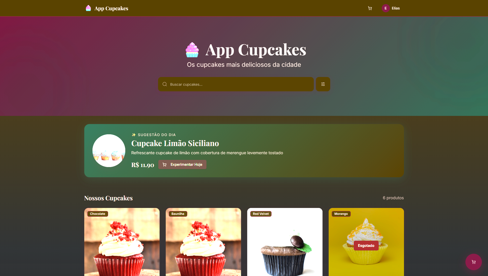
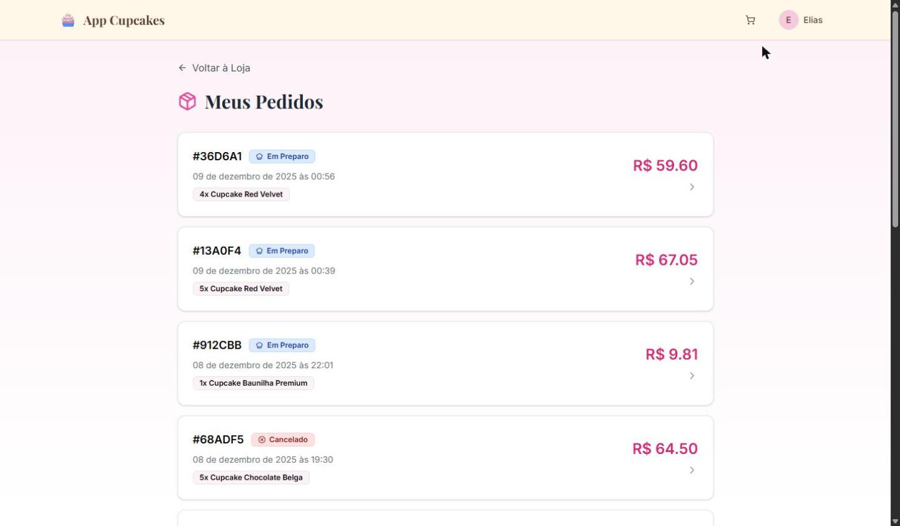
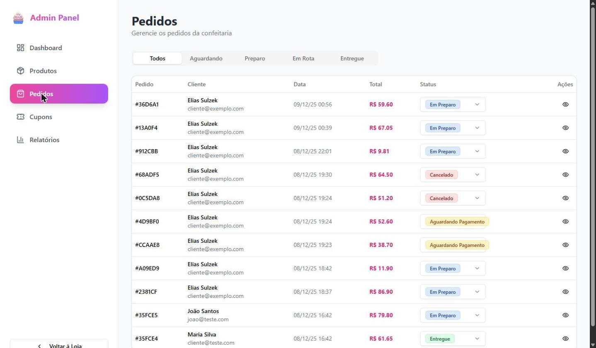
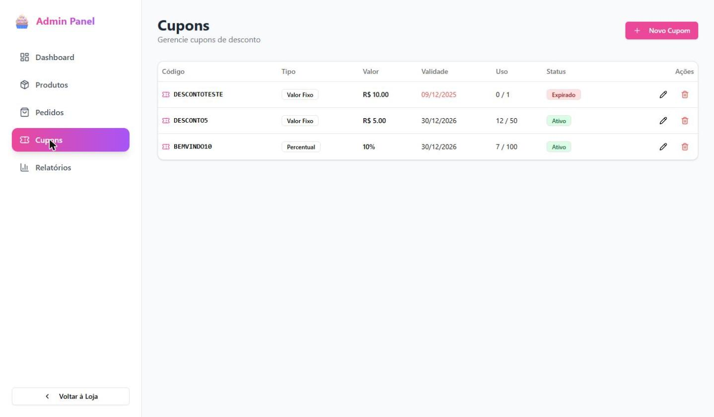
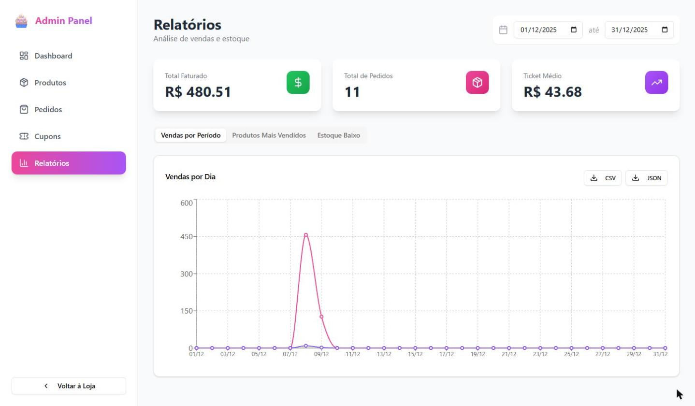

# 🧁 App Cupcakes




## 📱 Sobre o Projeto

O **App Cupcakes** é um e-commerce de cupcakes artesanais desenvolvido inteiramente na plataforma no-code **Base44**, com uma área para clientes e um painel para o administrador.

Projeto final do curso de Engenharia de Software, com foco em **modelagem de dados, arquitetura, documentação e testes**.

## 🔗 Sistema Publicado

> **Link da Aplicação:** [cupcake-delight-ebdbb888.base44.app](https://cupcake-delight-ebdbb888.base44.app)

## ✨ Funcionalidades

A lista abaixo descreve o que o app faz na versão publicada. O pagamento é **simulado** e não há integração com entrega, e-mail ou notificações.

### 👥 Área do Cliente

- **Catálogo de Produtos:** cards com foto, sabor, descrição, preço e nota média, mais uma "Sugestão do Dia"
- **Busca e Filtros:** busca por texto, filtro por sabor e por faixa de preço
- **Detalhe do Produto:** estoque disponível, seletor de quantidade e avaliações de outros clientes
- **Carrinho de Compras:** painel lateral com adição, remoção e ajuste de quantidades
- **Checkout:** dados de entrega, cupom de desconto e escolha entre Pix, Cartão de Crédito e Boleto
- **Pagamento Simulado:** confirmação sem cobrança real; o pedido passa para "Em Preparo"
- **Meus Pedidos:** lista de pedidos com status e detalhes
- **Rastreamento:** Aguardando Pagamento → Em Preparo → Em Rota → Entregue (ou Cancelado), atualizado ao recarregar a página
- **Meu Perfil:** telefone, CEP, endereço, cidade e estado

### 🔧 Área Administrativa

- **Dashboard:** total faturado, pedidos de hoje, produtos (com contagem de estoque baixo), pedidos pendentes, produtos mais vendidos, pedidos por status e pedidos recentes
- **Produtos:** cadastro, edição e remoção de cupcakes (nome, descrição, preço, sabor, estoque, URL da imagem e status)
- **Pedidos:** lista com filtros por status e atualização do status do pedido
- **Cupons:** criação e gestão de cupons (percentual ou valor fixo, validade e limite de usos)
- **Relatórios:** relatórios de vendas e de produtos, com exportação de dados

## 📸 Capturas de Tela

### Área do Cliente

| Catálogo | Carrinho |
| --- | --- |
|  |  |

| Checkout | Meus Pedidos |
| --- | --- |
|  |  |

| Rastreamento do Pedido |
| --- |
|  |

### Painel Administrativo

| Dashboard | Pedidos |
| --- | --- |
|  |  |

| Produtos | Cupons |
| --- | --- |
|  |  |

| Relatórios |
| --- |
|  |

## 🏗️ Arquitetura

O app usa a infraestrutura gerenciada da Base44: interface, backend serverless, banco de dados, autenticação e hospedagem são fornecidos pela plataforma.

- **Frontend:** interface responsiva gerada pela Base44
- **Backend:** lógica configurada na plataforma, sem servidores próprios
- **Dados:** entidades gerenciadas pela Base44 (`Produto`, `Pedido`, `Pagamento`, `Avaliacao`, `Cupom` e `User`)
- **Autenticação:** login e controle de acesso nativos da Base44
- **Deploy:** publicação e hospedagem pela plataforma

> 📖 Detalhes em [docs/arquitetura.md](./docs/arquitetura.md) e [docs/modelagem-de-dados.md](./docs/modelagem-de-dados.md)

## 📁 Estrutura do Repositório

```
app-cupcakes/
│
├── README.md                    # Este arquivo
│
└── docs/                        # Documentação do projeto
    ├── AVISO.md                 # Informações sobre o código-fonte
    ├── arquitetura.md           # Arquitetura do sistema
    ├── modelagem-de-dados.md    # Entidades e relacionamentos
    ├── funcionalidades.md       # Funcionalidades e itens fora do escopo
    ├── testes.md                # Casos de teste e resultados
    ├── laudo-de-qualidade.md    # Autoavaliação de qualidade
    └── prints/                  # Capturas de tela
        ├── cliente/             # Telas da área do cliente
        └── admin/               # Telas da área administrativa
```

## 📚 Documentação

- [**AVISO.md**](./docs/AVISO.md): natureza no-code do projeto e ausência de código-fonte
- [**arquitetura.md**](./docs/arquitetura.md): arquitetura e infraestrutura
- [**modelagem-de-dados.md**](./docs/modelagem-de-dados.md): entidades do app e limitações do modelo
- [**funcionalidades.md**](./docs/funcionalidades.md): o que o app faz e o que não faz
- [**testes.md**](./docs/testes.md): casos de teste manuais e bugs corrigidos
- [**laudo-de-qualidade.md**](./docs/laudo-de-qualidade.md): autoavaliação de qualidade

## ⚠️ Importante: Código-Fonte

> **Este repositório contém apenas DOCUMENTAÇÃO.**

A Base44 não permite a exportação do código-fonte no plano utilizado. O desenvolvimento foi feito pela interface da plataforma.

**O que você encontra aqui:** documentação, modelagem de dados, descrição de funcionalidades, casos de teste e autoavaliação.

**O que não está neste repositório:** código-fonte, arquivos de build e dependências.

Para mais informações, leia [docs/AVISO.md](./docs/AVISO.md).

## 🚀 Como Acessar o Sistema

Use o link da aplicação no topo deste documento.

**Área do cliente:** crie sua conta pela tela de login da Base44. Não são fornecidas contas de demonstração.

**Área administrativa:** o acesso é restrito ao proprietário do app. As telas estão em [docs/funcionalidades.md](./docs/funcionalidades.md) e em `docs/prints/admin`.

## 🧑‍💻 Desenvolvimento

- **Plataforma:** Base44 (no-code)
- **Tipo de projeto:** e-commerce de cupcakes (B2C)
- **Ambiente:** cloud

## 📞 Contato

**Elias Gonçalves Sulzek**

- E-mail: [eliasgoncalves3107@gmail.com](mailto:eliasgoncalves3107@gmail.com)
- LinkedIn: [linkedin.com/in/elias-sulzek-26b259233](https://www.linkedin.com/in/elias-sulzek-26b259233/)
- GitHub: [github.com/eliassulzek](https://github.com/eliassulzek)

## 📄 Licença

Projeto acadêmico, sem fins comerciais.

---

Desenvolvido por Elias Gonçalves Sulzek usando a plataforma no-code Base44.
