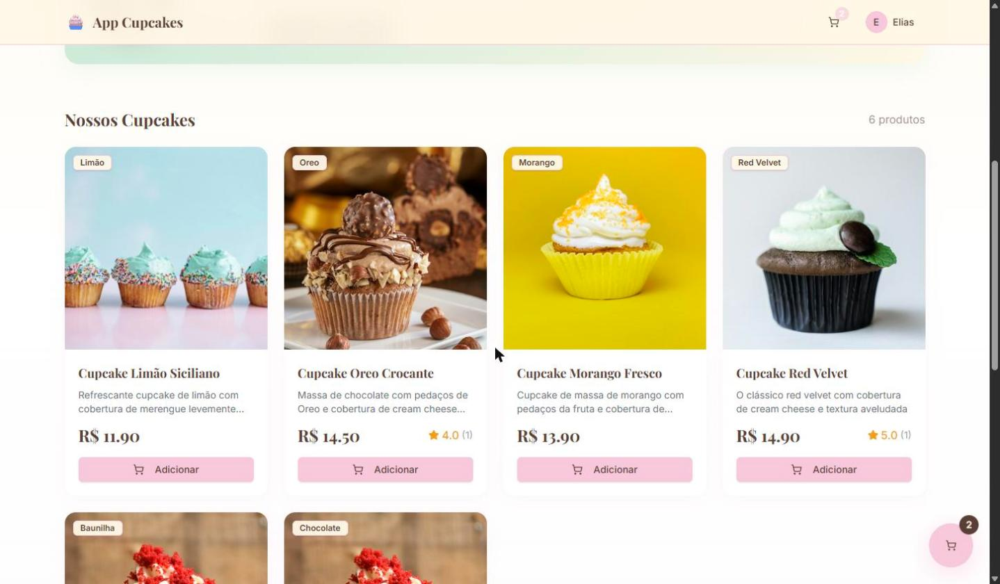
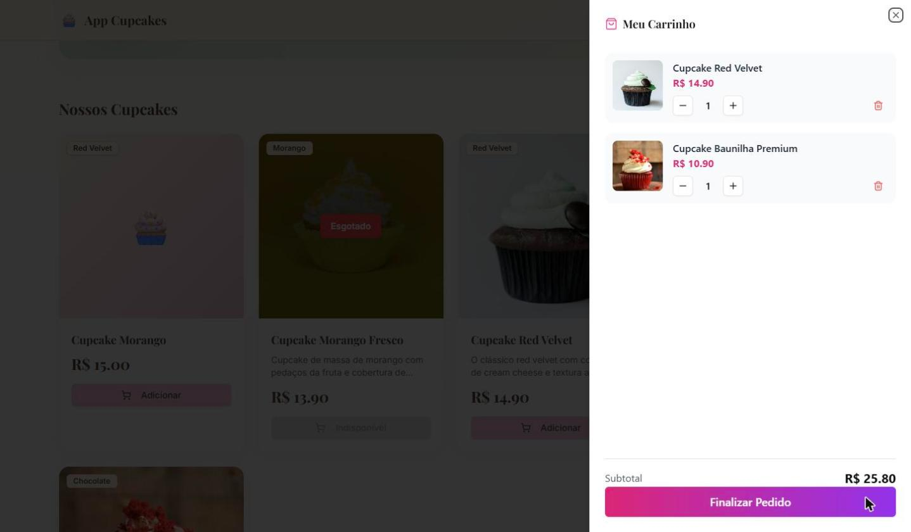
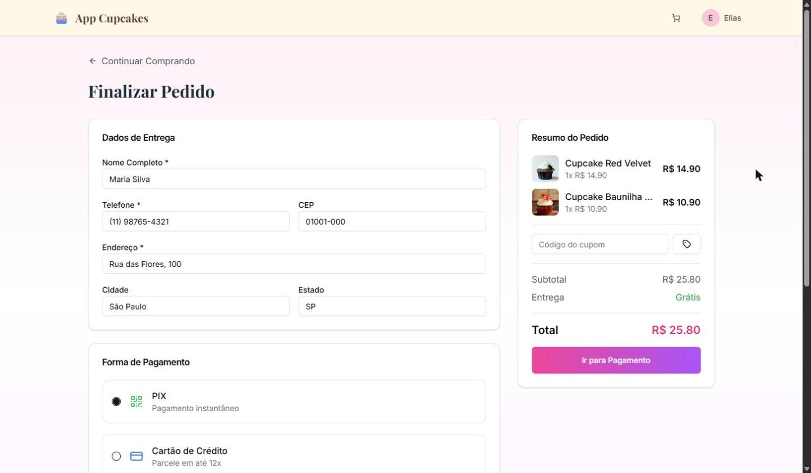
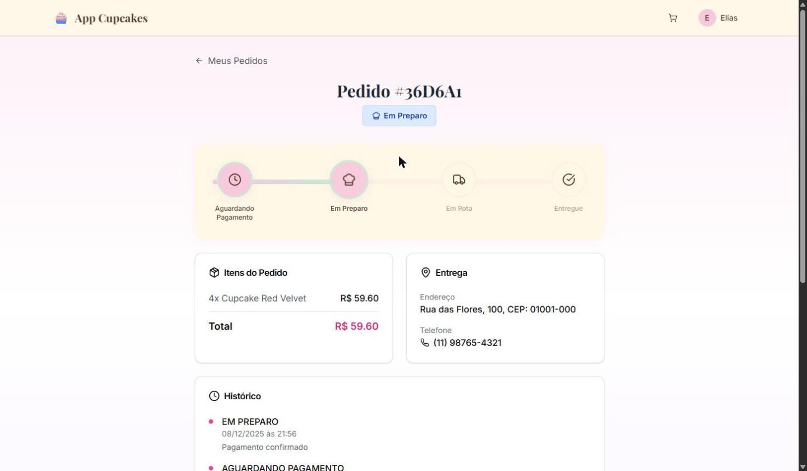
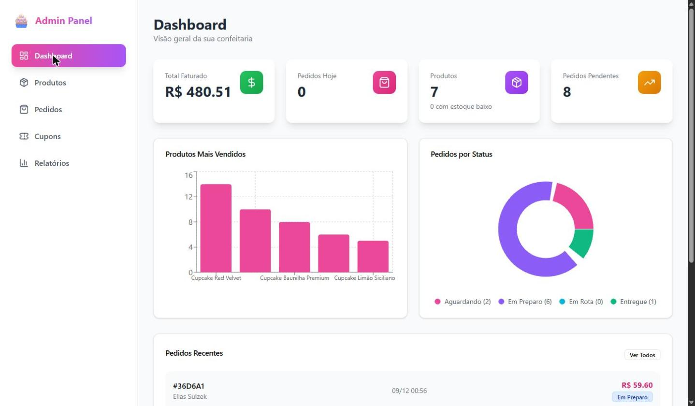
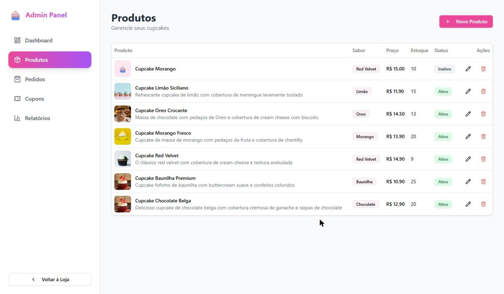

# 🧁 App Cupcakes


## 📱 Sobre o Projeto

O **App Cupcakes** é uma plataforma de e-commerce especializada na venda de cupcakes artesanais, desenvolvida inteiramente na plataforma no-code **Base44**. O sistema oferece uma experiência moderna e intuitiva tanto para clientes quanto para administradores.

Projeto final do curso de Engenharia de Software, com foco em **modelagem de dados, arquitetura, documentação e testes**.

## 🔗 Sistema Publicado

> **Link da Aplicação:** [cupcake-delight-ebdbb888.base44.app](https://cupcake-delight-ebdbb888.base44.app)

## ✨ Funcionalidades Principais

### 👥 Área do Cliente

- **Catálogo de Produtos:** visualização completa dos cupcakes disponíveis, com fotos e descrições
- **Busca e Filtros:** busca com filtros por categoria, preço e sabor
- **Carrinho de Compras:** adição, remoção e ajuste de quantidades
- **Checkout Simplificado:** processo de compra rápido e intuitivo
- **Pagamento Simulado:** sistema de pagamento para demonstração (Pix, Cartão, Boleto)
- **Histórico de Pedidos:** acompanhamento completo de todas as compras
- **Status em Tempo Real:** rastreamento do pedido (Aguardando Pagamento → Em Preparo → Em Rota → Entregue)
- **Sistema de Avaliações:** avaliação de produtos e da experiência de compra
- **Perfil do Usuário:** gerenciamento de dados pessoais e endereços

### 🔧 Área Administrativa

- **Dashboard Analítico:** visão geral de vendas, pedidos e performance
- **Gráficos e Métricas:** análise visual de vendas por período e produtos mais vendidos
- **CRUD de Produtos:** cadastro completo de cupcakes (nome, descrição, preço, imagem, categoria)
- **Gestão de Estoque:** controle de quantidade disponível e alertas de estoque baixo
- **Gerenciamento de Pedidos:** visualização e atualização de status dos pedidos
- **Sistema de Cupons:** criação e gestão de cupons de desconto
- **Relatórios:** exportação de dados de vendas e pedidos nos formatos CSV e JSON

## 📸 Capturas de Tela

### Área do Cliente

| Catálogo | Carrinho |
| --- | --- |
|  |  |

| Checkout | Meus Pedidos |
| --- | --- |
|  |  |

| Rastreamento do Pedido |
| --- |
|  |

### Painel Administrativo

| Dashboard | Pedidos |
| --- | --- |
|  |  |

| Produtos | Cupons |
| --- | --- |
|  |  |

| Relatórios |
| --- |
|  |

## 🏗️ Arquitetura

O App Cupcakes utiliza arquitetura serverless e a infraestrutura no-code da Base44, permitindo desenvolvimento rápido, escalabilidade automática e deploy sem configuração de servidores.

- **Frontend:** interface responsiva gerada automaticamente pela Base44
- **Backend:** API REST serverless, com lógica de negócio configurada visualmente
- **Banco de Dados:** PostgreSQL gerenciado (relacional)
- **Autenticação:** sistema de login e controle de acesso nativo da Base44
- **Deploy:** publicação automática e hospedagem em infraestrutura cloud

> 📖 Para detalhes completos da arquitetura, consulte [docs/arquitetura.md](./docs/arquitetura.md)

## 📁 Estrutura do Repositório

```
app-cupcakes/
│
├── README.md                    # Este arquivo
│
└── docs/                        # Documentação completa do projeto
    ├── AVISO.md                 # Informações sobre o código-fonte
    ├── arquitetura.md           # Arquitetura detalhada do sistema
    ├── modelagem-de-dados.md    # Esquema do banco de dados
    ├── funcionalidades.md       # Documentação de todas as funcionalidades
    ├── testes.md                # Casos de teste e resultados
    ├── laudo-de-qualidade.md    # Relatório de qualidade do sistema
    └── prints/                  # Capturas de tela
        ├── cliente/             # Telas da área do cliente
        └── admin/               # Telas da área administrativa
```

## 📚 Documentação

Toda a documentação técnica e funcional está na pasta [`/docs`](./docs):

- [**AVISO.md**](./docs/AVISO.md): informações importantes sobre a natureza no-code do projeto
- [**arquitetura.md**](./docs/arquitetura.md): descrição técnica da arquitetura e da infraestrutura
- [**modelagem-de-dados.md**](./docs/modelagem-de-dados.md): modelo completo do banco de dados
- [**funcionalidades.md**](./docs/funcionalidades.md): documentação detalhada de todas as funcionalidades
- [**testes.md**](./docs/testes.md): plano de testes, casos de teste e resultados
- [**laudo-de-qualidade.md**](./docs/laudo-de-qualidade.md): avaliação da qualidade do sistema

## ⚠️ Importante: Código-Fonte

> **Este repositório contém apenas DOCUMENTAÇÃO.**

A Base44 é uma plataforma no-code que não permite a exportação de código-fonte. Todo o desenvolvimento foi realizado por interface visual, com configurações e lógica de negócio definidas diretamente na plataforma.

**O que você encontra aqui:**

- ✅ Documentação completa do projeto
- ✅ Modelagem de dados e arquitetura
- ✅ Descrição de funcionalidades
- ✅ Casos de teste e laudos de qualidade

**O que não está neste repositório:**

- ❌ Código-fonte (não exportável da Base44)
- ❌ Arquivos de configuração de build
- ❌ Dependências de pacotes

Para mais informações, leia [docs/AVISO.md](./docs/AVISO.md).

## 🚀 Como Acessar o Sistema

O sistema está publicado na plataforma Base44. Use o link da aplicação no topo deste documento.

**Área do cliente:** crie sua própria conta pela tela de cadastro. A Base44 usa verificação por e-mail (código de autenticação), por isso não são fornecidas contas de demonstração.

**Área administrativa:** a autenticação administrativa é gerenciada pela Base44 e apenas o proprietário possui essa permissão. As funcionalidades do painel estão documentadas em [docs/funcionalidades.md](./docs/funcionalidades.md) e nas capturas de tela em `docs/prints/admin`.

## 🧑‍💻 Desenvolvimento

- **Plataforma:** Base44 No-Code Platform
- **Tipo de projeto:** e-commerce de cupcakes
- **Modelo:** B2C (Business to Consumer)
- **Ambiente:** cloud (serverless)

## 📞 Contato

**Elias Gonçalves Sulzek**

- E-mail: [eliasgoncalves3107@gmail.com](mailto:eliasgoncalves3107@gmail.com)
- LinkedIn: [linkedin.com/in/elias-sulzek-26b259233](https://www.linkedin.com/in/elias-sulzek-26b259233/)
- GitHub: [github.com/eliassulzek](https://github.com/eliassulzek)

## 📄 Licença

Projeto acadêmico, sem fins comerciais. Este repositório não inclui código-fonte exportável.

---

Desenvolvido por Elias Gonçalves Sulzek usando a plataforma no-code Base44.
